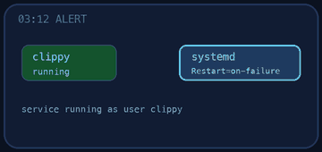
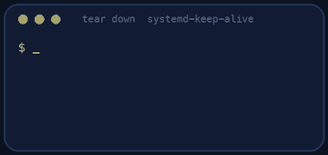

<p align="center"></p>

| | |
|-|-|
| **Time** | 60-75 min |
| **Cost** | free |
| **You need** | Your Ubuntu environment (WSL with systemd, or an OrbStack machine) with sudo |

## How this lab works

1. **Fork** this repository to your own GitHub account (button at the top right).
2. Clone **your fork** in your Ubuntu environment (WSL on Windows, your OrbStack machine on Mac).
3. Read the lab below (the same text is in [`LAB.md`](LAB.md)) and follow the mission.
4. Answer the questions in [`SUBMISSION.md`](SUBMISSION.md). Where a question asks for output, paste it in a code block. No screenshots needed.
5. Commit and push. Open the **Actions** tab of your fork (click *I understand my workflows, go ahead and enable them* the first time). The **Lab check** shows what is still missing.
6. When the check is green, **submit the URL of your fork** in the course platform.

> [!NOTE]
> The check only looks at your answers and any files the lab asks you to commit. Your instructor reads your work and may ask you to explain any line.

<p align="center"></p>

## 🎬 The situation

<p align="center"></p>

Friday, 18:02. Someone restarted the Clipstr staging server for a kernel update. Clipstr was running because one engineer had typed `nohup uvicorn ... &` in an SSH session weeks ago. After the reboot nobody started it again. Short links returned errors for three hours until a customer tweeted about it.

On Monday your lead says: *"A server should keep our app alive by itself. Not a person, not a terminal. Make it so, and then try your best to kill it."*

> [!IMPORTANT]
> **Your mission**
> - See why the current way of running Clipstr is fragile
> - Turn Clipstr into a **systemd service** that starts at boot and restarts itself after a crash
> - Break it in three different ways and read what systemd tells you each time
> - Lock the service down so a bug in Clipstr cannot become a bug in the whole server

**Time:** 60-75 min | **Cost:** free | **You need:** your Ubuntu environment with `sudo` (WSL with systemd, or your OrbStack machine). Open **two terminal tabs**: you will want logs in one while you act in the other.

<p align="center"></p>

## Part 0 - Set the scene

Fork this repository, clone your fork inside your Ubuntu environment, then run:

```bash
sudo ./setup.sh
```

It installs Clipstr in `/opt/clipstr` and starts it the way it was started on Friday. The last line should be a JSON `{"status":"ok","version":"manual-start",...}`.

> `setup.sh` needs a systemd-enabled environment. On WSL, if it complains, follow the hint it prints (a two-line change in `/etc/wsl.conf`, then `wsl --shutdown` in PowerShell).

<p align="center"></p>

## Part 1 - Recon: how is it running today?

<p align="center"></p>

Keep notes of your findings, you will need them for your submission.

1. Find the Clipstr process. Which **user** runs it, which **PID**, and what is its **parent PID**? (`ps -o pid,ppid,user,cmd -C uvicorn`)
2. Ask systemd about it: `systemctl status clipstr`. What does it say, and what does that tell you?
3. Where do the app's logs go? (`cat /tmp/clipstr-manual.log`). Would they survive a reboot?

> [!NOTE]
> **Predict**
> You are about to simulate the Friday reboot with `sudo ./chaos.sh reboot`. After it, what will `curl localhost:8000/healthz` return? Write your prediction down, run it, and compare.

Run it, then `curl localhost:8000/healthz`.

> [!NOTE]
> **Think** Nothing "crashed" here and nobody made a mistake. What was missing?

<p align="center"></p>

## Part 2 - Build: make the server responsible

You will write a unit file by hand. The goal is a file you could explain line by line to a colleague.

### 2.1 The requirements

| Need | Hint |
|------|------|
| Runs as the `clipstr` user, never root | `User=` |
| Runs from `/opt/clipstr` | `WorkingDirectory=` |
| Starts Clipstr with the venv's uvicorn on port 8000 | `ExecStart=` needs the **full path** to `/opt/clipstr/venv/bin/uvicorn` |
| Reports its version as `systemd-v1` in `/healthz` | The app reads `APP_VERSION`. Put it in a file `/etc/clipstr/clipstr.env` and load it with `EnvironmentFile=` |
| Comes back after a crash, but waits 2 seconds first | `Restart=` and `RestartSec=` |
| Starts at boot, after the network is up | `After=network.target` and `WantedBy=multi-user.target` |

Create the unit at `/etc/systemd/system/clipstr.service` (use `sudo nano` or `sudo tee`). Read `man systemd.service` or search "systemd.service Restart" if you need the exact options.

### 2.2 Start it

```bash
sudo systemctl daemon-reload
sudo systemctl enable --now clipstr
```

> [!NOTE]
> **Predict** Port 8000 is still used by the old manual process, if it is somehow still alive. What do you expect? (If you ran `chaos.sh reboot` it is dead, so the new service starts cleanly.)

> [!TIP]
> **Checkpoint**
> - `systemctl status clipstr` shows `active (running)` and `enabled`
> - `curl localhost:8000/healthz` now reports `"version":"systemd-v1"`
> - Copy your finished unit file into the repo as `clipstr.service` and commit it

<p align="center"></p>

## Part 3 - Watch it live

Open the second terminal and follow the logs:

```bash
journalctl -u clipstr -f
```

In the first terminal send some traffic:

```bash
curl -s -X POST localhost:8000/shorten -H 'content-type: application/json' -d '{"url":"https://ironhack.com"}'
curl -s localhost:8000/stats
```

Watch the lines appear. These logs now live in the **journal**, not in a file somebody has to remember.

> [!NOTE]
> **Think** What did you gain compared with `/tmp/clipstr-manual.log`? Try `journalctl -u clipstr --since "5 minutes ago"` and `journalctl -u clipstr -p err`.

<p align="center"></p>

## Part 4 - Break it (three ways)

### 4.1 The crash

> [!NOTE]
> **Predict** You will kill Clipstr with `sudo ./chaos.sh kill` (a `kill -9`). How long until it is back, and will the PID change?

Note the `MainPID` first (`systemctl show clipstr -p MainPID,NRestarts`), run the chaos script, wait 4 seconds, and look again. In the log terminal find the sentences `Main process exited`, `Scheduled restart job` and `Started`. **Copy those lines for your submission.**

### 4.2 The polite stop

> [!NOTE]
> **Predict** Now send a polite `SIGTERM`: `sudo kill -TERM $(systemctl show clipstr -p MainPID --value)`. Will `Restart=on-failure` bring Clipstr back?

Check with `systemctl is-active clipstr`. Was the prediction right? Look at the log: how did uvicorn exit? Then change the unit to `Restart=always`, reload, start it, and repeat the `kill -TERM`. What changed?

> [!NOTE]
> **Think** When is it good that a service does not come back after a stop? When would you absolutely want `Restart=always`?

Set the unit back to what you prefer for Clipstr and make sure it is running.

### 4.3 The typo

A teammate "tidies" the unit file. Edit `ExecStart` and change `uvicorn` to `uvicorm`. Then:

```bash
sudo systemctl daemon-reload
sudo systemctl restart clipstr
systemctl status clipstr
```

Read the status output carefully. It shows an exit status and the service flapping between `activating (auto-restart)` and failed. Find the **exact code** (it looks like `status=203/EXEC`) and look it up: `man systemd.exec`, section *Process exit codes*.

> [!WARNING]
> **Break it**
> Fix the typo, then add a second, different mistake of your choice (wrong `WorkingDirectory`, wrong `User`, a missing `EnvironmentFile`). For each one note: which command revealed it, and which words in the output pointed at the cause. This is the debugging loop you will use for the rest of your career: **status, then journal, then man page**.

Restore a working unit before moving on.

<p align="center"></p>

## Part 5 - Lock it down

Clipstr is internet-facing. If someone finds a bug in it, what could they do on this server? systemd can answer that:

```bash
systemd-analyze security clipstr
```

The last line is an exposure score (0 is perfectly locked down, 10 is wide open). Keep the output.

Now harden the `[Service]` section. Add directives, one or two at a time, run `daemon-reload` and `restart`, and check Clipstr still answers on `/healthz`. At least these:

- `NoNewPrivileges=yes`
- `PrivateTmp=yes`
- `ProtectSystem=strict` and `ProtectHome=yes`
- `PrivateDevices=yes`
- `RestrictAddressFamilies=AF_INET AF_INET6 AF_UNIX`

Look at the other rows `systemd-analyze security` marks with a red cross and pick more that make sense. Run the command again and keep the new output next to the old one. Your goal is a score **below 6.0**.

> [!TIP]
> **Stuck?** If a directive makes the service fail to start, systemd tells you in `status`. Remove the last one you added and try again. Clipstr keeps everything in memory, so it needs almost nothing from the filesystem.

> [!NOTE]
> **Note for OrbStack users:** OrbStack machines run in a container and neutralise some sandboxing directives at runtime, so `systemctl show` may print `NoNewPrivileges=no` even though your unit says `yes`. On a real server or in WSL they bite. Keep them in your unit anyway; the checks read your unit file.

<p align="center"></p>

## Level up (optional)

- **Resource limits.** Add `MemoryMax=100M` and `CPUQuota=50%`. Watch `systemctl status clipstr` show the limits. What would happen if Clipstr leaked memory now?
- **Drop-ins.** Instead of editing the unit, run `sudo systemctl edit clipstr` and override `RestartSec`. Look in `/etc/systemd/system/clipstr.service.d/`. Why is this the better way to change vendor-provided units?
- **A timer instead of cron.** Write `clipstr-report.service` and `clipstr-report.timer` that curl `/stats` every minute. Check it with `systemctl list-timers`.

<p align="center"></p>

## Verify

<p align="center"></p>

```bash
sudo ./verify.sh
```

You need **ALL CHECKS PASSED**. `verify.sh` kills your service on purpose to prove it comes back, so do not be alarmed.

<!-- teardown:start (generated by labs.py, do not edit) -->
## Tear down (mandatory)

<p align="center"></p>

Resources left behind cost money, keep doors open and pollute the next lab. Removing what you created is part of the job, so it is part of the submission: **you must prove it is gone**.

Do this **last**, after you have pasted your `verify` output into `SUBMISSION.md` (once you tear down, the lab can no longer be verified).

1. Run `sudo ./teardown.sh`. It stops and removes the service, the `clipstr` user, `/opt/clipstr` and `/etc/clipstr`.

Then run the proof:

```bash
sudo ./verify-teardown.sh
```

It prints a list of checks and must end with **TEARDOWN VERIFIED**. If it reports leftovers, remove them and run it again. Paste the full output in your submission.
<!-- teardown:end -->

<!-- submission:start (generated by labs.py, do not edit) -->
## 📬 Submission

<p align="center"></p>

Answer the questions in `SUBMISSION.md` in **your fork** (paste output in code blocks where asked), push, then submit the **URL of your fork**.

**Files to commit**

- `clipstr.service`: your unit file, committed to the repo

**Questions to answer**

1. In Part 1, what supervised the app (what did `systemctl status` say), and why did that make it fragile? What exactly happened to it when you ran `chaos.sh reboot`?
2. Paste the journal lines showing systemd noticing your `kill -9` and restarting Clipstr (`Main process exited`, `Scheduled restart job`, `Started`).
3. You killed Clipstr with `kill -9` and with `kill -TERM`. Which one did `Restart=on-failure` bring back, and why? When would you choose `Restart=always` instead?
4. With the broken `ExecStart`, which line in `systemctl status` or `journalctl` told you the real cause? Copy it and explain it.
5. Paste the last line of `systemd-analyze security clipstr` before and after hardening. Name three directives you added and what each one prevents.
6. Paste the output of `sudo ./verify.sh`. It must end with **ALL CHECKS PASSED**.
7. **Tear down.** Paste the output of `sudo ./verify-teardown.sh`. It must end with **TEARDOWN VERIFIED**.
<!-- submission:end -->
